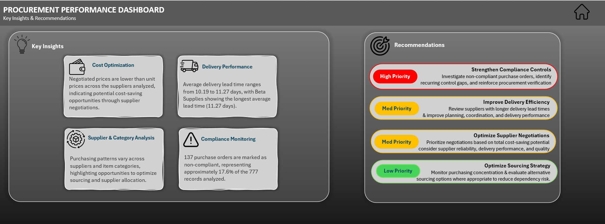

# Procurement Performance Dashboard

An Excel dashboard analyzing 777 purchase orders across 5 suppliers to track cost savings, compliance, and delivery performance.

## Highlights

- **777** purchase orders, **850,551** units
- **3,638,920** total cost savings (~8% below list price, excluding cancelled orders)
- **82.4%** compliance rate (137 non-compliant orders)
- **10.8 days** average delivery lead time

## Key Findings

- Compliance is the biggest gap: Delta Logistics has 67 non-compliant orders, Epsilon Group only 3.
- Lead times are close across suppliers (10.19 to 11.27 days), with Beta Supplies the slowest.
- Negotiated prices beat list prices for every supplier.

## Tools

Excel · PivotTables · Slicers & Timeline · Formulas (IF, OR, IFERROR, AVERAGE, GETPIVOTDATA) · Conditional Formatting · KPI Reporting · Data Cleaning

Calculated columns (lead time, saving per unit, saving %, total cost savings) were built with formulas, and conditional formatting highlights delivery lead times against the 10.8-day average.
## Files

- `PROCUREMENT_PERFORMANCE_DASHBOARD.xlsx`: the workbook (open in Excel 2013 or later)

**Lara Kashmeri** · [Portfolio](https://larakashmeri.github.io/) · [LinkedIn](https://www.linkedin.com/in/lara-kashmeri-158951244)
